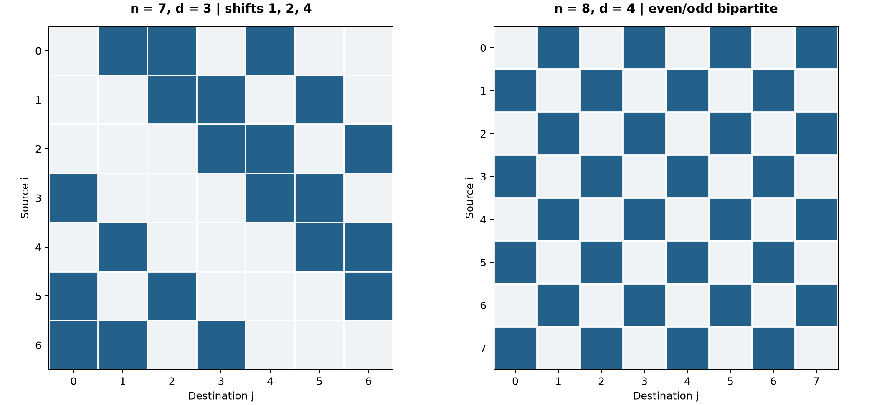

# Assignment 4: Maximum Concurrent Flow and Network Design

Bhavin Gupta | CS 422: Computer Networks | Fall 2026

Repository: [https://github.com/bvin02/CS42200-Fall26-Assignment4](https://github.com/bvin02/CS42200-Fall26-Assignment4)

The code jointly optimizes a directed graph and its splittable routing. Every node has exactly d unit-capacity outgoing links and d unit-capacity incoming links. Self-links and parallel links are excluded. The objective is the largest multiplier lambda for which every demand can be routed simultaneously.

## 1. Uniform traffic: an exact graph construction

For general n and d, set T[s,t] = d/(n-1) when s != t. The following finite construction returns a globally optimal topology, including cases where (n-1) is divisible by d:

```
best_value = -infinity
for every 0/1 adjacency matrix X with X[i,i] = 0,
    each row sum d, and each column sum d:
    solve the splittable-flow LP for this fixed X and uniform T
    if its optimal lambda exceeds best_value:
        best_value = lambda; best_graph = X
return all arcs i -> j for which best_graph[i,j] = 1
```

The code solves the equivalent integrated mixed integer linear program, avoiding a separate LP for each graph. The construction is exact: any allowed graph occurs in the enumeration, and the LP computes its best concurrent flow; conversely, the returned graph and LP routing attain the selected value. It may be computationally expensive for large n, but it does not assume an unproved optimal graph family.

There is a useful universal bound. Among n(n-1) ordered source-destination pairs, exactly nd pairs can have a direct link. Every other pair needs at least two hops. The total carried edge-volume for uniform traffic at multiplier lambda is at least

```
lambda * d/(n-1) * [nd + 2(n(n-1)-nd)]
    = lambda * nd * [2 - d/(n-1)].
```

Only nd edge-capacity units exist. Thus lambda <= (n-1)/(2(n-1)-d). Equality requires all nondirect traffic to use two hops and all edges to be fully utilized; the bound need not be attainable for every n,d.

### Explicit optimum for n = 7, d = 3

Label nodes 0,...,6. From each i, add arcs to i+1, i+2, and i+4 modulo 7. This is a simple directed 3-in/3-out graph. Here T[s,t] = 1/2 for s != t. Set lambda = 2/3, so each ordered pair receives 1/3 unit. Send direct-neighbor traffic on its direct arc. A missing offset is 3, 5, or 6. Split each such pair equally between the two two-hop paths with shifts (1,2)/(2,1), (1,4)/(4,1), or (2,4)/(4,2), respectively.

Every arc carries 1/3 direct traffic. Each shift appears in exactly two of those missing-offset decompositions; each adds 1/3 transit traffic to every arc of that shift. Hence each arc carries exactly 1. The bound above equals 6/(12-3) = 2/3, so this topology and routing are globally optimal. This example satisfies the assignment's simplifying condition 6 divisible by 3.

For the 8-node, degree-4 comparison, another explicit optimum is the bidirectional complete bipartite graph between even and odd nodes. Its uniform optimum is 0.7. Each pair receives (4/7)(0.7) = 0.4. Send opposite-parity pairs directly. Split each same-parity pair evenly over the four opposite-parity intermediates. Every arc carries 0.4 direct + 0.3 first-hop + 0.3 second-hop = 1. The bound is 7/(14-4) = 0.7. The 8-node example does not need the simplifying divisibility condition.

## 2. Arbitrary 8 x 8 hose traffic: exact mixed integer linear program

The input matrix is fixed when optimizing. The hose set in the displayed definition uses row sums <= 4 and column sums <= 4, with nonnegative entries and zero diagonal. The prose below that definition says totals equal 4; the displayed inequalities govern the implementation. A matrix may therefore have sparse or underfilled rows and columns.

Decision variables, for distinct i,j and each destination t:

- x[i,j] in {0,1}: whether directed arc i -> j exists.
- f[t,i,j] >= 0: aggregate flow on arc i -> j destined for t. Set f[t,t,j] = 0; flow need not leave its destination.
- lambda >= 0: concurrent-flow multiplier. There is no artificial lambda <= 1 cap, since an underfilled hose matrix may scale above 1.

Maximize lambda subject to:

```
x[i,i] = 0                                 for every i
sum(j != i) x[i,j] = 4                     for every i
sum(j != i) x[j,i] = 4                     for every i
sum(t != i) f[t,i,j] <= x[i,j]             for every i != j
sum(j != i) f[t,i,j] - sum(k != i,t) f[t,k,i]
    = lambda * T[i,t]                      for every i != t
sum(k != t) f[t,k,t] = lambda * sum(s != t) T[s,t]
                                            for every t
```

The degree equations create exactly 32 unit-capacity directed links. The capacity inequality couples all destinations sharing one link. Each non-destination node supplies its scaled demand for destination t; the destination absorbs the total. Source identities can be recovered by decomposing this nonnegative destination flow into source-to-t paths and discarding cycles. Thus aggregation by destination does not relax the routing requirement.

The formulation is exact for every nonzero input T in the hose set. Any graph and feasible per-pair routing yield feasible x,f,lambda by aggregating paths by destination. Conversely, the flow-decomposition argument turns any feasible x,f,lambda into valid per-pair paths on the selected graph. Maximizing lambda over the binary x variables therefore chooses the best topology for the given matrix. The all-zero matrix has no finite maximum scale and is rejected explicitly.

## 3. Solver results and verification

| Demand | n | d | Proven lambda | Independent upper bound |
|---|---:|---:|---:|---:|
| Uniform | 5 | 2 | 0.666667 | 0.666667 hop bound |
| Uniform | 7 | 3 | 0.666667 | 0.666667 hop bound |
| Uniform | 8 | 4 | 0.700000 | 0.700000 hop bound |
| Regular hose: four unit demands per row | 8 | 4 | 1.000000 | 1.000000 source cut |
| Sparse hose: T[0,1] = 1 only | 8 | 4 | 4.000000 | 4.000000 source/sink cuts |

For the regular example, the support graph itself has four outgoing and incoming edges at every node; direct routing achieves lambda = 1. For the sparse example, four edge-disjoint routes from 0 to 1 achieve lambda = 4. These distinct optimal values show why fixing lambda <= 1 would be wrong for the stated hose set.

Gurobi 13.0.3 returned OPTIMAL with zero reported MIP gap for every saved result. The 8-node model has 449 variables and 136 linear constraints, including 56 binary link decisions. The saved JSON files contain the selected edges, positive destination flow values, objective, solver bound, status, and runtime. `verify_solution` independently checks degrees, edge capacities, and all flow balances from the saved values. Six automated tests pass, including a direct verification of the explicit 7-node routing and both hose examples. Floating-point solver values are interpreted within 1e-5 feasibility tolerance.

The two explicit uniform topologies above are shown as adjacency matrices. A dark cell in row i, column j denotes directed arc i -> j. The 7-node graph uses modular shifts 1, 2, and 4; the 8-node graph joins every even node to every odd node in both directions. Each row and column contains exactly d dark cells.



## 4. Reproduction and source links

Reproduce:

```
python3 -m venv .venv
.venv/bin/python -m pip install -r requirements.txt
.venv/bin/python -m unittest discover -s tests -v
.venv/bin/python experiment.py --uniform 7 3 --output results/uniform_7_3.json
.venv/bin/python experiment.py --uniform 8 4 --output results/uniform_8_4.json
.venv/bin/python experiment.py --matrix inputs/regular_hose_8_4.json --output results/regular_hose_8_4.json
.venv/bin/python experiment.py --matrix inputs/sparse_hose_8_4.json --output results/sparse_hose_8_4.json
.venv/bin/python render_report.py
```

Relevant code: [uniform traffic and input validation](https://github.com/bvin02/CS42200-Fall26-Assignment4/blob/main/experiment.py#L20-L43), [exact Gurobi formulation](https://github.com/bvin02/CS42200-Fall26-Assignment4/blob/main/experiment.py#L46-L80), [solve and certificate](https://github.com/bvin02/CS42200-Fall26-Assignment4/blob/main/experiment.py#L83-L120), [independent verification](https://github.com/bvin02/CS42200-Fall26-Assignment4/blob/main/experiment.py#L123-L149), and [tests](https://github.com/bvin02/CS42200-Fall26-Assignment4/blob/main/tests/test_experiment.py#L1-L79).

AI assistance was used to draft and review the formulation, implementation, tests, and report. I reviewed the mathematical model and am responsible for explaining it during the oral exam.
